# BUTCH GRAVES 3D — Game Manual

Everything about playing the game: the story, the controls, every weapon, pickup, trap and gadget, every monster and
boss, all twenty levels with maps and every secret, the difficulty settings, options and cheats. For how the game was
made, see the [README](README.md); for building it and swapping in your own sounds, see the
[developer notes](DEVELOPER.md).

Numbers in this manual are for the normal difficulty (Treat) unless it says otherwise. The game runs at 20 ticks a
second, and a "cell" is one square of the map, about the width of a corridor.

**Contents**

1. [The story](#the-story)
2. [Starting a game](#starting-a-game)
3. [Controls](#controls)
4. [The screen](#the-screen)
5. [Getting around](#getting-around)
6. [Weapons](#weapons)
7. [Pickups](#pickups)
8. [Traps, hazards and gadgets](#traps-hazards-and-gadgets)
9. [Monsters](#monsters)
10. [Bosses](#bosses)
11. [The levels](#the-levels)
12. [Difficulty](#difficulty)
13. [Options](#options)
14. [Cheats and the test menu](#cheats-and-the-test-menu)

---

## The story

**Hollow Creek, October 31st.** For twenty years Butch Graves has dug the graves of this sleepy town. Tonight the
Harvest Cult lit the Great Jack-o'-Lantern on Blackwood Hill and woke the **Pumpkin King**, and the dead are clawing out
of Butch's cemetery. They're ruining his lawn.

| Episode | What happens |
|---|---|
| **1. Night of the Pumpkin King** | Butch fights from his cemetery up to the cult's manor, down through the catacombs, and out under a blood moon into the Pumpkin King's own patch. |
| **2. Carnival of Carnage** | Mister Giggles' Traveling Carnival of Souls rolls into town at midnight. Clowns in the diner, skeletons in the hardware store. Butch hates clowns. |
| **3. Bite Night** | A contract signed in blood shows who paid for all of this: Count Hollowfang, in the castle across the swamp. |
| **4. Voltage of the Damned** | The Count's mad scientist, Dr. Viktor Franken, has fled through a time portal to Halloween 2099. Butch follows him into a neon future full of robots. |
| **5. Curse of the Jade Skull** | A telegram from Professor Alistair Crane calls Butch to the jungles of Xochitlan, where a treasure hunt for the Jade Skull of Seven Death, Lord of the Underworld, is going very wrong. |

The story is told on illustrated pages between levels (5 or Down turns the page, Up goes back, the soft key skips),
and every episode ends with an animated cutscene after the boss fight.

## Starting a game

- **Installing:** copy `dist/ButchGraves3D.jar` (1.7 MB, with voices) or `dist/ButchGraves3D_lite.jar` (under 1 MB,
  subtitles only) to the phone, with its `.jad` if the phone wants one. It also runs in J2ME Loader, KEmulator and
  FreeJ2ME.
- **New Game** asks for an episode (Doom style: any episode can be played first) and a difficulty, then shows the
  episode's opening story.
- You start every episode with the **shovel**, the **Silver .44** and 40 silver bullets. Within an episode you keep your
  weapons, ammo, health and armor from level to level. When you finish an episode and carry on into the next one, you
  keep your arsenal and your health is topped up to at least 100.
- The game **saves at the start of every level**. **Continue** on the title screen takes you back to the start of the
  last level you reached, with what you carried in.
- **Dying** buries Butch. After a moment, 5 restarts the level with the health, armor, weapons and ammo you entered it
  with; the soft key goes back to the title.
- Each level opens with a title card that melts away, Doom style. At the exit a **tally screen** shows your kills,
  secrets found and time.

## Controls

| Key | Action |
|---|---|
| 2 / Up | Walk forward. Double-tap and hold to **sprint**. |
| 8 / Down | Walk back |
| 4 / 6, Left / Right | Turn (turning speeds up while you hold the key) |
| 1 / 3 | Strafe left / right |
| 5 / Fire | Shoot (hold for automatic fire) |
| 0 | Use: open doors, pull levers, press the exit switch, and open **secret walls** (only 0 opens those) |
| 7 / 9 | Previous / next weapon |
| # | Jump |
| * | Automap (type cheat codes here, see the end of this manual) |
| Left or right soft key | Pause menu: Resume, Automap, Options, Controls, Quit to title |
| 5 or soft key in a cutscene | Skip it. A "5: skip" hint shows when it's ready; holding or hammering fire as a boss dies won't skip anything. |
| `*` `*` `*` on the title screen | The test menu |

## The screen

  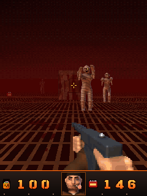

- **Status bar**, bottom: your **health** (with **armor** under it once you have some), **Butch's face**, the ammo for
  the weapon in your hand, and coloured tags for the **skull keys** you hold. The face gets more battered below 60 and
  25 health, winces when you're hit, and grins when you kill something or find a gun. On small screens the status bar
  uses smaller digits and stacks health and armor.
- **Stamina bar**: a thin bar above the status bar whenever you're short of breath: yellow while you sprint, blue while
  it refills, red when you've run it dry.
- **Boss bar**: in a boss fight, the boss's name and health across the top of the screen.
- **Messages**: pickups, locked doors, secrets and tips appear at the top. The first time you see a new kind of trap,
  a tip tells you how to deal with it.
- **Crosshair** in the middle (it can be switched off in Options).
- The screen flashes red when you're hurt and gold when you pick something up.
- **Butch talks.** He has a one-liner for almost every kind of monster he kills, for finding a gun or a secret, for
  low health ("I need candy. Lots of candy."), and for each boss.

## Getting around

- **Walking speed.** Butch walks about 2.3 cells a second, backs up a little slower, and strafes a little slower. He
  outwalks almost every monster: only a pouncing skull-spider or jaguar warrior is faster, and nothing catches him when
  he sprints.
- **Sprinting.** Double-tap 2 and hold it. A sprint runs at 3.6 cells a second for about five and a half seconds. The
  stamina bar refills in about eight seconds, but if you run it completely dry Butch needs two seconds to catch his
  breath first, and he can't start a sprint on an almost empty bar.
- **Jumping** (#). A walking jump clears a one-cell gap. Sprint before you jump the two-cell ones. You also jump over
  pressure plates and over Frankenstein Prime's shockwaves.
- **Doors** open when you walk into them or press 0, and close on their own after about five seconds unless something
  is standing in them. Monsters open ordinary doors too.
- **Locked doors** are coloured red, blue or gold and need the matching **skull key**. Walk into one without the key and
  a message tells you which key it wants.
- **Secret walls.** Every level except the boss arenas and the Circuit Maze hides at least one. A secret wall looks
  almost like the wall around it: look for a hairline gap around the panel and a dark crack where it meets the floor.
  Press 0 on it and it slides away from you and stays open. Secrets count on the tally screen. The level maps below show
  where every one is.
- **The exit** is a stone wall with a glowing **EXIT** sign: walk into it or press 0.
- **The automap** (* or from the pause menu) shows everything you've seen: walls, doors in their key colours, the exit,
  keys and teleporter pads. Secret walls show as ordinary walls until you open them.

## Weapons

| | Weapon | Ammo | Damage per hit | Rate of fire | Notes |
|---|---|---|---|---|---|
| 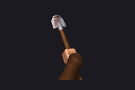 | **Shovel** | none | 30–46 | a swing every 0.55 s | Hits the closest monster about a cell in front of you. Makes no noise, so it doesn't wake monsters in the next room. The only weapon (with explosions) that finishes off a downed mummy. |
| 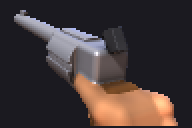 | **Silver .44** | silver bullets | 22–34 | about 3 shots a second | Accurate. Shares its bullets with the Tommy Gun. |
| 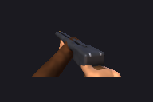 | **Boomstick** (double barrel) | shells | 7 pellets × 8–14 | a shot every 1.1 s | Up to 98 damage up close. The pellets spread wide, so step in before you fire. |
| 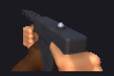 | **Tommy Gun** | silver bullets | 11–17 | 6–7 bullets a second | The best damage over time, but it eats bullets fast. |
| 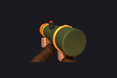 | **Pumpkin Launcher** | pumpkin bombs | 140 at the centre of the blast, down to 0 at 2 cells | a shot every 0.9 s | Fires an exploding jack-o'-lantern that bursts on the first monster or wall it touches. **Its blast hurts you too** (at half strength). Explosions blow monsters to pieces and set off powder kegs. |

- **Ammo limits:** 200 silver bullets, 50 shells, 30 pumpkin bombs.
- When a gun runs dry, Butch switches by himself, in this order: Tommy Gun, Boomstick, Silver .44, Pumpkin Launcher,
  shovel.
- **Every gunshot makes noise.** Monsters within about 9 cells hear it and come looking. The shovel is silent.
- **Gibbing.** A monster killed by an explosion with plenty of damage to spare is blown to bits ("Who ordered extra
  crispy?"). Bones, ghosts, bats, brides, robots, conquistadors and the weeping woman fall apart in their own ways
  instead.

## Pickups

| | Pickup | Effect |
|---|---|---|
|  | **Candy corn** | +10 health, up to 100 |
|  | **Bucket of candy** | +30 health, up to 100 |
| 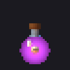 | **Witch's Brew** | +100 health, **up to 200**. Most levels have one, usually behind the secret wall. |
| 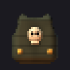 | **Bone armor vest** | Armor 100. Armor soaks up half of every hit until it's used up. |
| 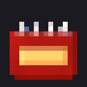 | **Silver bullets** | +24 bullets (the .44 and the Tommy Gun) |
| 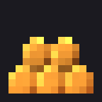 | **Shotgun shells** | +8 shells |
| 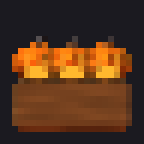 | **Pumpkin bombs** | +4 bombs |
| 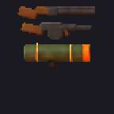 | **Boomstick / Tommy Gun / Launcher** | The weapon, plus 10 shells / 50 bullets / 6 bombs. A weapon you already have still gives its ammo. |
|  | **Skull keys** (red, blue, gold) | Open the doors of their colour. Each level's keys open its own doors only. |
|  | **The Golden Idol** | The Lost Temple's gold key... and it sets off the temple (see [the boulder](#traps-hazards-and-gadgets)). |

Pickups you can't use (candy at full health, ammo at the limit) stay on the floor for later. On the easier and harder
settings some health and ammo pickups are left out (see [Difficulty](#difficulty)), but every room with monsters in
it keeps at least one pickup. In the boss arenas nothing is left out, and pickups come back after a while: 20 seconds
on Trick, 30 on Treat, 45 on Nightmare.

## Traps, hazards and gadgets

Damage from every hazard is scaled by the difficulty like everything else that hurts you.

**Everywhere**

| | Hazard | What it does |
|---|---|---|
| 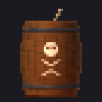 | **Powder keg** | One or two shots and it explodes: up to 150 damage, 2 cells across. Kegs set each other off. |
| 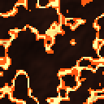 | **Lava and rivers of fire** | 10 damage every 0.7 s while you stand in it (the Pumpkin King's patch, Xibalba) |
|  | **Slime** | 6 every 0.7 s (the Bone Catacombs) |
| 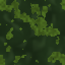 | **Swamp water** | 3 every 0.7 s (Blackwater Bayou) |
| 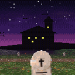 | **Lightning** | On the stormy outdoor levels the sky flashes and thunder rolls. It looks great and hurts nobody. |

**Episode 4 (Halloween 2099)**

| | Gadget | What it does |
|---|---|---|
|  | **Teleporter pad** | Step on it and you arrive at its partner pad somewhere else. Anything standing on the arrival point is telefragged (bosses only take 60). |
| 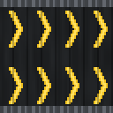 | **Conveyor belt** | Carries you along in the direction of its arrows (monsters keep their footing). |
| 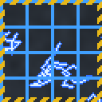 | **Shock floor** | Switches on for 2.75 s and off for 4 s, and flickers just before it comes on. 6 damage every 0.45 s while it's live. |
| 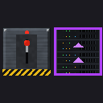 | **Lever and shifting walls** | Press 0 on a lever panel: every shifting wall in the level sinks into the floor, and every hidden one rises. Anything standing where a wall rises is crushed. Some walls hide robot lockers. |
| 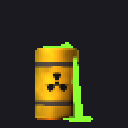 | **Toxic waste barrel** | Explodes like a powder keg, a little harder (170). |

**Episode 5 (the jungle)**

| | Trap | What it does |
|---|---|---|
| 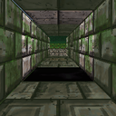 | **Pit** | Fall in and Butch climbs back out where he last stood, 15 damage the poorer. Jump over (sprint for the wide ones). Walking monsters won't step in. |
| 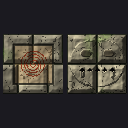 | **Pressure plate and dart traps** | Step on a plate and every dart trap within 5 cells fires across the corridor: 6–10 per dart. Jump over the plates. |
| 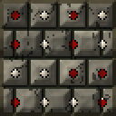 | **Spike floor** | Down for 3 s, up for 1.7 s, with a click just before they rise. 8 damage every 0.4 s while they're up. They stab monsters too. |
| 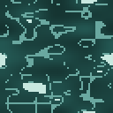 | **River** | Wading slows you to 60% speed. |
| 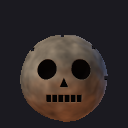 | **The rolling boulder** | When the Golden Idol is lifted, a stone skull boulder drops from the ceiling and rolls down the escape tunnel. It is faster than walking and a little slower than sprinting. If it catches you it shoves you along for 28 damage; if it pins you against a wall, it's over. It flattens monsters in its path. **Sprint.** |
| 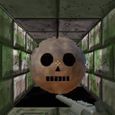 | **The temple's trigger** | Lifting the idol also seals the way you came in, grinds open the escape tunnel, and wakes jaguar warriors and a mummy in the plaza outside. |
| 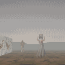 | **The pocket radio** | In the fog town it crackles with static when a monster is near: every 1.2 s for something within 10 cells, every 0.65 s within 6, and every 0.3 s within 3. The fog hides them; the radio doesn't. |
| 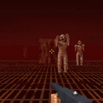 | **The siren and the Other World** | In the fog town, taking the red key sounds an air-raid siren. The world fades to black and comes back rusted and bloody, with blood-red fog, new music, and a crowd of new monsters already hunting you. |

## Monsters

**How they behave.** Monsters sleep until they see you (within 13 cells, in a clear line of sight) or hear a gunshot
(within 9 cells). Then they follow you around walls and through ordinary doors. Hit monsters often flinch, which
holds them up for a moment; some flinch much more than others. Ranged attackers need a clear shot and fire from up to 15
cells away, and every projectile can be dodged. Nobody can open locked doors or secret walls but you.

Damage is per hit on Treat (half on Trick, 130% on Nightmare). Health is on Treat; monsters have 85% of it on Trick and
125% on Nightmare.

### Episode 1

| | Monster | Health | Speed | Attacks | What to know |
|---|---|---|---|---|---|
| 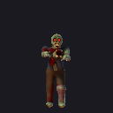 | **Ghoul** | 55 | steady | claws 6–10 | The rank and file of the dead. Flinches at almost every hit. Two or three .44 shots. |
| 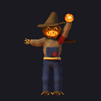 | **Pumpkin Scarecrow** | 90 | slow | fireball 10–18, swipe 6–10 | Lobs fireballs from a distance. |
| 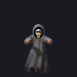 | **Wraith** | 60 | very fast | claws 7–11 | A see-through ghost that floats in fast. Moans when it's close. |
| 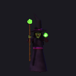 | **Witch** | 100 | slow | green bolt 12–20, slap 5–8 | The hardest-hitting bolts in Episode 1. Flinches less than most. |

### Episode 2

| | Monster | Health | Speed | Attacks | What to know |
|---|---|---|---|---|---|
| 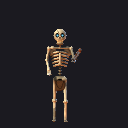 | **Skeleton** | 50 | quick | rusty cutlass 7–11 | Fast but brittle. Falls apart in a heap of bones. |
|  | **Evil Clown** | 70 | steady | throws knives 7–12, slap 5–8 | Comes in crowds and giggles a lot. |

### Episode 3

| | Monster | Health | Speed | Attacks | What to know |
|---|---|---|---|---|---|
| 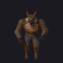 | **Werewolf** | 150 | quick | claws 10–17 | Lunges at double speed when it gets within 2–7 cells. Tough, and hard to make flinch. The Boomstick's job. |
| 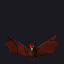 | **Vampire Bat** | 20 | very fast | bite 3–5 | Flies high and erratic in swarms. Almost any hit kills it. |
| 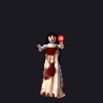 | **Vampire Bride** | 110 | steady | blood bolt 9–16, bite 6–10 | Hovers. When she's hit, one time in four she vanishes in smoke and reappears a couple of cells away. |

### Episode 4

| | Monster | Health | Speed | Attacks | What to know |
|---|---|---|---|---|---|
| 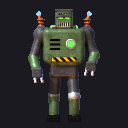 | **Franken-bot** | 170 | slow | ball lightning 10–16, punch 9–15 | Its ball lightning is slow but **follows you** for about five seconds before it fizzles out. Keep moving, or put a wall between you. Blows up (harmlessly) when destroyed. |
| 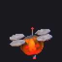 | **Jack-o-Drone** | 40 | quick | laser 5–9 | A flying pumpkin that circles you and **backs off** when you get within 4 cells. Its lasers are inaccurate. |
| 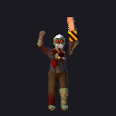 | **Cyber-Ghoul** | 90 | quick | chainsaw arm 9–15 | You hear the saw before you see it. |
|  | **Skull-Spider** | 30 | very fast | bite 3–6 | The fastest thing in the game, and it pounces. Weak, and comes in swarms. |

### Episode 5

| | Monster | Health | Speed | Attacks | What to know |
|---|---|---|---|---|---|
| 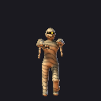 | **Mummy** | 110 | slow | punch 9–16 | **Gets back up.** A mummy killed by bullets collapses, and 7–11 seconds later rises again with half its health (it waits while you stand right next to it). To keep one down, finish it on the ground with the **shovel** or an **explosion**. A mummy killed outright by the shovel, an explosion, spikes, the boulder or a falling wall stays dead. |
| 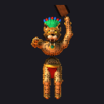 | **Jaguar Warrior** | 70 | very fast | club 8–13 | Pounces with a roar, faster than you can walk. |
| 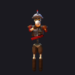 | **Conquistador ghost** | 60 | steady | arquebus ball 14–21, sword 6–11 | Takes **aim for over a second** (listen for the click), then fires a heavy, fast musket ball, then needs 4–6 seconds to reload. When you hear the click, step sideways. |
| 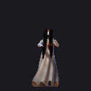 | **La Llorona, the weeping woman** | 70 | quick | touch 7–12 | A see-through ghost who floats and wails. When she's 5–16 cells away, every 9–15 seconds she vanishes and **reappears 3–5 cells from you, somewhere you aren't looking**. When hit she sometimes slips away a short distance. Turn around when you hear her wail. |

## Bosses

Every boss has a health bar, notices you from much further away than other monsters, and every so often summons helpers:
every 26 seconds on Trick, 17 on Treat and 14 on Nightmare, 1, 2 or 3 at a time, as long as there aren't already more than
4, 6 or 7 monsters alive. **Below 40% health every boss is enraged** and attacks more often. Boss arenas have no
secrets, but their supplies come back.

| Boss health | Trick | Treat | Nightmare |
|---|---|---|---|
| The Pumpkin King | 1,020 | 1,700 | 2,040 |
| Mister Giggles | 1,500 | 2,500 | 3,000 |
| Count Hollowfang | 1,260 | 2,100 | 2,520 |
| Frankenstein Prime | 1,440 | 2,400 | 2,880 |
| Seven Death | 1,440 | 2,400 | 2,880 |

### The Pumpkin King

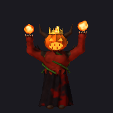

The cult's god, crowned in fire, in a pumpkin patch under a blood moon.

- **Fire volley:** three big fireballs in a spread, 11–18 each.
- **Claws:** 13–22, with a long reach.
- **Summons** wraiths and ghouls in a burst of green flame.
- **Tips:** the arena is split by lava pools; keep a pillar between you and the volleys and strafe through the gaps
  between fireballs. The corners hold supply caches, one with a Witch's Brew.

### Mister Giggles

The ringmaster of the Carnival of Souls, in the centre ring of the Big Top.

- **Knife fan:** five knives in a wide fan (three on Trick), 7–12 each.
- **Juggling bombs:** one time in four, he lobs two juggling bombs instead. They bounce off walls and explode when they
  land or reach you: 28 damage at the centre.
- **Slap:** 15–25.
- **Summons** clowns and skeletons.
- **Tips:** the knives spread out with distance, so fight him from mid-range where you can slip between them, and keep
  moving when the bombs fly.

### Count Hollowfang

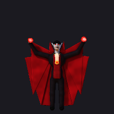

Three hundred years old, on his throne under the full moon.

- **Blood bolts:** three in a spread, 9–16 each.
- **Bite:** 13–22.
- **Teleports:** he vanishes in a puff of bats and reappears 5–13 cells away, whenever you get within 4 cells of him and
  every 10–13 seconds anyway (sooner on Nightmare). Getting hurt can make him go early.
- **Summons** vampire bats, plus a werewolf on Treat and Nightmare.
- **Tips:** don't chase him; let him come back to you, and keep the bats thinned out.

### Frankenstein Prime

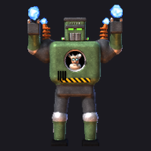

Forty tons of stitched steel with Dr. Franken in the cockpit, above the reactor.

- **Tesla volley:** five bolts in a fan (three on Trick), 9–14 each.
- **The stomp:** when you're within 7 cells, he stomps and a **ring of lightning** spreads out across the floor, up to 9
  cells. **Jump (#) as it reaches you.** If it hits, it does 14–22 and throws you in the air. He stomps every 7–10
  seconds on Treat, more often when enraged.
- **Crush:** 16–27 up close.
- **Summons** skull-spiders and Jack-o-Drones.
- **Tips:** the arena's edge is a moving walkway and the reactor is ringed by a shock floor; use the pillars for cover.

### Seven Death, Lord of Xibalba

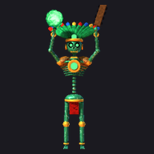

The jade skeleton king of the Maya underworld, on his obsidian throne.

- **Jade discs:** a fan of three spinning discs, 9–14 each (five when he's enraged).
- **Obsidian club:** 13–22, and it **knocks you flying** half a cell (watch out near the abyss).
- **The slam:** he slams the floor and the roof comes down. **Dust trickles where each rock will fall, one right above
  you.** Move away from the dust: 12–18 per rock. Four rocks on Trick, five on Treat, six on Nightmare, two more when
  he's enraged.
- **Summons** mummies and jaguar warriors (mummies here get back up too, so finish them).
- **Tips:** the arena is crossed by rivers of fire with stone bridges, and there's an abyss at both edges. Stay mobile
  between the pillars and never stand still after a slam.

## The levels

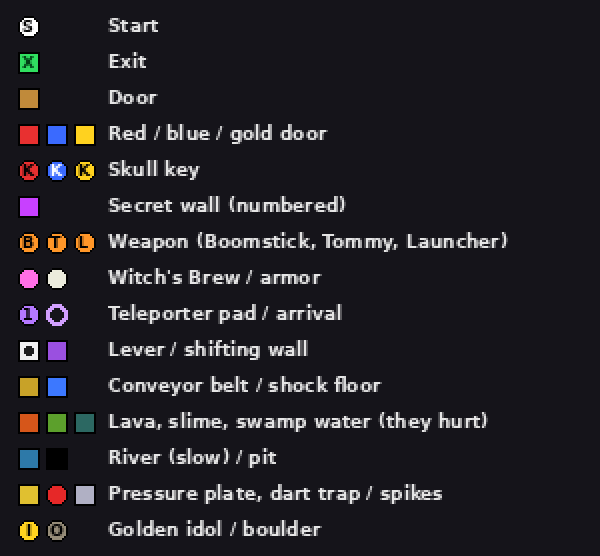

Every map shows the whole level. Secret walls are numbered stars; the text says what's behind each. Monster counts are
for Trick / Treat / Nightmare (Trick also leaves out every third ordinary monster).

### Episode 1: Night of the Pumpkin King

#### 1. Dead End Cemetery

*Night 1, Hollow Creek.* Monsters 7 / 17 / 20: ghouls, scarecrows, wraiths. Stormy sky.

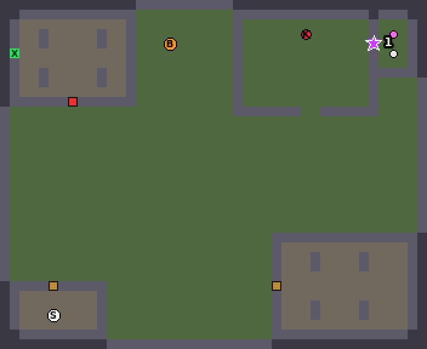

You start in the caretaker's shack. Dirt paths cross the graveyard between rows of tombstones.

- **Boomstick:** in an open grave at the north end of the graveyard.
- **Red key:** in the walled pumpkin patch to the north-east; get in through the gap in the hedge.
- **Exit:** inside the mausoleum in the north-west, behind the red door.
- A ruined chapel in the south-east is worth a look.
- **Secret 1:** the east wall of the pumpkin patch is a hedge that slides away. Behind it: a **Witch's Brew** and **bone
  armor**.

#### 2. Blackwood Manor

*Night 2, the cult house.* Monsters 5 / 18 / 19: ghouls, wraiths, witches, scarecrows.

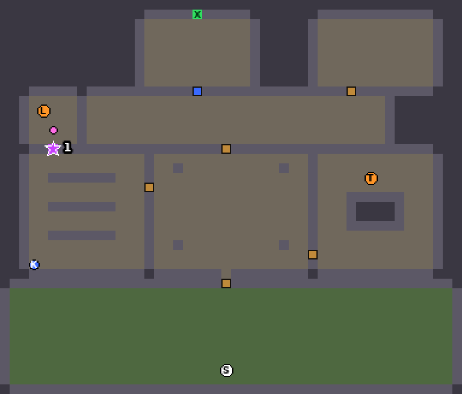

From the front courtyard into the manor's grand hall.

- **Tommy Gun:** in the dining room of the east wing, by the long table.
- **Blue key:** in the library of the west wing.
- **Exit:** the crypt stairs behind the blue door, north of the gallery corridor.
- **Secret 1:** a bookshelf in the library is a door. Behind it: the **Pumpkin Launcher**, pumpkin bombs and a
  **Witch's Brew**.

#### 3. The Bone Catacombs

*Night 3, under Blackwood.* Monsters 7 / 17 / 18: ghouls, scarecrows, wraiths, witches.

Tunnels dug by the cult over a hundred Halloweens. From the start crypt in the south-west, a hub ossuary leads east.

- **The slime hall** east of the hub hurts to walk in; cross by the stone bridge.
- **Pumpkin Launcher:** in the shrine north of the slime hall.
- **Gold key:** in the crypt east of the slime hall.
- **Exit:** the harvest altar behind the gold door, at the end of the north corridor.
- A crypt loop in the south-east has extra supplies.
- **Secret 1:** a skull wall off the north corridor. Behind it: a **Witch's Brew** and **bone armor**.

#### 4. The Pumpkin King's Patch

*Night 4, blood moon.* The Pumpkin King and 3 / 7 / 9 helpers.

An open arena under a blood-red sky, cut up by lava pools, pillars of flesh and walls of pumpkins. Supplies wait in the
four corners (a Witch's Brew in the north-west one, pumpkin bombs in two others, a bucket of candy in the last) and
come back after a while. See [the Pumpkin King](#the-pumpkin-king).

### Episode 2: Carnival of Carnage

#### 5. Main Street Mayhem

*Downtown Hollow Creek.* Monsters 12 / 28 / 33: ghouls, clowns, skeletons, a witch.

- **Boomstick:** right in front of you at the start.
- **Red key:** behind the counter of the diner.
- **Blue key:** in the hardware store, behind the red door.
- **Exit:** the carnival gate at the east end of the street, behind the blue door.
- Also: the candy shop, an alley and back lot, and the town park.
- **Secret 1:** a brick wall off the back lot opens into a garage: **Witch's Brew**, **bone armor** and bullets.

#### 6. The Midway

*Mister Giggles' carnival.* Monsters 10 / 24 / 27: clowns, skeletons, wraiths, witches, ghouls.

From the entrance plaza up the midway between the game booths.

- **Red key:** in the carousel ring to the west.
- **Tommy Gun and gold key:** in the freak show tent, behind the red door.
- **The haunted house ride** to the east is a dark maze full of ghosts.
- **Exit:** the funhouse entrance at the north end, behind the gold door.
- **Secret 1:** the ride's maintenance room, hidden in the haunted house ride. Inside: **Witch's Brew**, **bone armor**
  and pumpkin bombs.

#### 7. The Funhouse

*Laugh till you die.* Monsters 8 / 19 / 22: clowns, skeletons, witches, wraiths.

- **The hall of mirrors** is a grid maze; the **blue key** is in its far west corner.
- **Red key:** in the clown room to the east.
- **Pumpkin Launcher:** in the prize room behind the red door.
- **Exit:** the tunnel of terror, through the blue door off the mirror hall, north to the exit.
- **Secret 1:** a hidden mirror near the north wall slides away to a stash: **Witch's Brew**, **bone armor** and bullets.

#### 8. The Big Top

Mister Giggles and 2 / 4 / 5 of his troupe.

A round tent with poles, bleachers and the centre ring; you come in from the backstage alley in the south. Supplies come
back. See [Mister Giggles](#mister-giggles).

### Episode 3: Bite Night

#### 9. Blackwater Bayou

*The swamp road.* Monsters 8 / 24 / 25: bats, werewolves, ghouls, witches, vampire brides. Stormy.

Mud islands joined by boardwalks; the **swamp water stings** (3 every 0.7 s), so stay on the boards.

- **Boomstick:** on the boat dock where you start.
- **Red key:** in the voodoo shack on the west island.
- **Tommy Gun:** in the ruined chapel on the central island, guarded by a vampire bride.
- A werewolf den waits on the south-east island.
- **Exit:** the castle road gate in the north, behind the red door.
- **Secret 1:** the hermit's hut in the north-east: **Witch's Brew**, **bone armor** and bullets.

#### 10. The Mad Lab

*Under Castle Hollowfang.* Monsters 12 / 21 / 24: skeletons, werewolves, brides, ghouls, bats, a witch.

Up the entry stairs into the specimen hall.

- **Blue key:** in the generator room to the west, among the tesla coils.
- **Pumpkin Launcher and red key:** in the operating theatre to the east.
- **The cells** behind the blue door hold prisoners turned skeletons, a Witch's Brew and bullets.
- **Exit:** the stairs up into the castle, behind the red door.
- **Secret 1:** a barred lab panel in the north wall. Behind it: **bone armor**, pumpkin bombs and candy.

#### 11. Castle Hollowfang

*The Count's home.* Monsters 10 / 24 / 26: brides, bats, werewolves, skeletons, a witch.

From the courtyard into the great hall.

- **Red key:** in the library-crypt of the west wing, among the coffins.
- **Blue key:** in the armory of the east wing, behind the red door.
- **Gold key:** in the north gallery, behind the blue door.
- **Exit:** the tower stairs behind the gold door.
- **Secret 1:** a tapestry in the north-west hides a room with a **Witch's Brew**, **bone armor** and bullets.

#### 12. The Count's Throne

Count Hollowfang and 2 / 4 / 5 of his brood. Stormy.

The castle roof under the full moon: you climb out of the tower stair in the south, and the throne dais is in the north,
between pillars and braziers. Supplies come back. See [Count Hollowfang](#count-hollowfang).

### Episode 4: Voltage of the Damned

#### 13. Neon Graveyard

*Neo-Hollow, 2099.* Monsters 11 / 24 / 32: Franken-bots, skull-spiders, drones, cyber-ghouls.

A holo-cemetery under a neon skyline. The **shock floors** start here, and so do the **teleporters**.

- **Boomstick:** in front of you at the start, in the south-west plaza.
- **Red key:** in the tech mausoleum.
- **The factory yard** is behind the red door; a teleporter there takes you to the walled-off old cemetery in the
  north-west, where the **blue key** is, and another brings you back.
- **Exit:** through the blue door and up the shock-floor gauntlet to the Frankentech gate.
- **Secret 1:** the old cemetery's east wall hides a stash: the **Tommy Gun**, bullets and candy.
- **Secret 2:** a maintenance tunnel behind the cemetery wall in the south-west: **bone armor**, pumpkin bombs and a
  bucket of candy... and two skull-spiders.

#### 14. The Assembly Line

*Frankentech Industries.* Monsters 10 / 25 / 30: cyber-ghouls, Franken-bots, drones, spiders.

Everything here moves. The **conveyor belts** carry you around; watch where they're taking you.

- Hall 1, north of the loading dock, has three belts running north.
- **Red key:** on the platform of the sorting room in the north-west, where rows of belts shove you toward a shock strip.
- **The paint shop** behind the red door has a belt loop around its walls, spray booths and toxic waste, plus the
  **blue key** and the **Tommy Gun**.
- **The control corridor** behind the blue door has a **lever**. It drops the barrier ahead, but raises walls behind you
  and opens the **robot lockers**.
- **Exit:** the lift at the end of the control corridor.
- **Secret 1:** a paint store room off the south wall of the paint shop: **bone armor**, **Witch's Brew** and pumpkin
  bombs.

#### 15. The Circuit Maze

*The mainframe.* Monsters 17 / 31 / 34: skull-spiders, cyber-ghouls, Franken-bots, drones.

The doctor's server racks rearrange themselves whenever someone pulls a **lever**: every shifting wall (purple on the
map) drops and every hidden one rises. Some passages are only open in one state, so pull a lever whenever you're stuck.

- **Start:** the hub in the south-west, which has a lever of its own.
- **Red key:** in the north-west node of the west server maze, behind a shifting wall.
- **The core** in the middle has a shock floor around a reactor column, the **Pumpkin Launcher**, and a teleporter to
  the east stacks (another brings you back).
- A long dark corridor along the south is open only in the starting state (an even number of pulls).
- **Blue key:** in the room behind the red door, south of the core.
- **Exit:** the north passage, which has a shifting floor and the blue door.
- **The trap:** a dead end of the west maze holds a teleporter... into a room full of skull-spiders, with a pad home.
- This level has no secret walls; the maze is the secret.

#### 16. Frankenstein Prime

*The reactor.* Frankenstein Prime and 2 / 3 / 4 helpers.

A moving walkway runs clockwise around the edge of the arena, the reactor in the middle is ringed by a shock floor, and
pillars give cover. There's bone armor and a Pumpkin Launcher at the start. Supplies come back. See
[Frankenstein Prime](#frankenstein-prime).

### Episode 5: Curse of the Jade Skull

#### 17. The Lost Temple

*Xochitlan, Day of the Dead.* Monsters 9 / 22 / 26 (2 / 4 / 5 of them appear only when the idol is
taken): mummies, jaguar warriors.

Bright jungle, green shade, and the first pits, darts and spikes.

- **Start:** the professor's empty camp in the south-west. The **Boomstick** is by his tent.
- **The jungle trail** goes north across a stream (wading is slow) to the ruins plaza in front of the temple.
- **The hall of darts** inside the temple has pressure plates across the floor and dart traps in both walls. **Jump
  every plate.**
- **The tomb gallery** has mummies and a spike floor.
- **The idol chamber** holds the **Golden Idol**. Taking it seals the way you came in, opens the escape tunnel to the
  south, and drops a **boulder** behind you. **Sprint down the tunnel**, and jump its pit and its pressure plate on the
  way.
- **The plaza ambush:** jaguar warriors (and on Treat and Nightmare a mummy) are waiting outside when you come out.
- **Exit:** the idol opens the **gold seal** on the east side; beyond it is the river dock and the exit.
- **Secret 1:** a glyph wall in the temple's entry hall hides a treasure room: the **Tommy Gun**, gold and bullets.
- **Secret 2:** the leaves at the back of the west glade, by the old stone head: **Witch's Brew**, **bone armor** and
  gold.

#### 18. River of Bones

*The conquistadors' fort.* Monsters 10 / 24 / 28: conquistador ghosts, mummies, jaguar warriors.

A river runs east to the great falls, with a muddy bank on each side.

- **Start:** the camp on the south bank. From there a village stands on stilts over the water.
- **The canyon** to the east is a set of ledges over a **chasm**. Jump the gaps (sprint for the wide ones) to reach the
  shrine.
- **Red key:** in the shrine, with dart traps either side and gold on the floor. A rope bridge leads home from its west
  door.
- **The fort** is on the north bank, behind the red gate at the end of the bridge. Its armory holds the **Tommy Gun**,
  and there are barracks.
- **Blue key:** in the chapel, guarded by mummies.
- **Exit:** through the blue door, up the spike cave to the falls overlook.
- **Secret 1:** the chapel's wall paintings hide a stash: a **Witch's Brew** and pumpkin bombs.
- **Secret 2:** under the floorboards of the south-west hut in the village: **bone armor** and pumpkin bombs.

#### 19. The Fog

*San Lazaro, midnight.* Monsters 10 / 26 / 31 (5 / 12 / 14 of them only after the siren): weeping women,
mummies, conquistador ghosts.

A mission town swallowed by a thick white fog: you can see a few steps, but your **pocket radio** can hear further.

- The streets lead north past adobe houses with barred windows to a plaza of candlelit altars.
- **Pumpkin Launcher:** in one of the houses on the south street.
- **Red key:** on the church altar at the north end. **Taking it sounds the siren**, and the town turns into the
  **Other World**: rust, blood-red fog, and a new crowd of monsters that are already looking for you.
- **Blue key:** in the mausoleum of the cemetery behind the red gate in the east.
- **Exit:** the crypt behind the church altar, through the blue door.
- **Secret 1:** the hearth of the first house on the south-west street hides a back room: **Witch's Brew** and **bone
  armor**. Get it before the siren.

#### 20. Xibalba

*The Place of Fear.* Seven Death and 1 / 3 / 4 helpers.

The underworld: rivers of fire with stone bridges, an abyss at both edges, and pillars for cover. Bone armor and a
Pumpkin Launcher wait at the start; supplies come back. See [Seven Death](#seven-death-lord-of-xibalba).

## Difficulty

| | Trick (easy) | Treat (normal) | Nightmare (hard) |
|---|---|---|---|
| Damage you take | 50% | 100% | 130% |
| Monster health | 85% | 100% | 125% |
| Boss health | 60% | 100% | 120% |
| Monster attacks | slower | normal | faster, with faster projectiles |
| Monsters | fewer (and every third ordinary one is left out) | normal | extra |
| Candy placed | about half | about 70% | just over half |
| Ammo placed | just over half | about 70% | about 80% |
| Boss summons | 1 every 26 s | 2 every 17 s | 3 every 14 s |
| Boss-arena supplies return after | 20 s | 30 s | 45 s |

Pickups are thinned out room by room, and no room loses all of its loot.

All five bosses are tuned to the same curve. A test bot that dodges, jumps and aims like a decent player beats every
boss on Trick with most of its health left, wins a little over half its fights on Treat (about 70% against the final
boss), and almost never wins on Nightmare.

## Options

| Option | Choices |
|---|---|
| Detail | High, Medium, Low. Medium halves the horizontal resolution, Low halves both; use Low on slow phones. |
| Music | On, Menus only, Off. **Menus only** plays music on the title, story and tally screens but not during play: on a phone that can't play sound effects over music (some Nokia Series 40 models), that's how you get every gunshot and voice back. The game never switches the music off by itself. |
| Sound FX | On, Off |
| Voice | On, Off (Butch's lines and the cutscene voices) |
| Vibration | On, Off (a buzz when you're hurt) |
| Crosshair | On, Off |
| FPS counter | On, Off. A second line shows what the phone's audio is doing: MUSIC ON or MUSIC STOPPED, then K (how often the music had to be restarted), W (how many effects may play at once over it), C (how far the effects backed off after audio hangs), NOMIX (the phone can't play effects over music), H (how many times the audio hung). |
| Cutscenes | **Classic**, or **Gory**: a cruder, bloodier cut of each ending where the villains get kicked, blown up and splattered across the camera lens. Only monsters and villains get hurt. |

During cutscenes, story pages and the tally screen the game keeps the phone's backlight on.

## Cheats and the test menu

**Automap codes.** Open the automap with * and type:

| Code | Effect |
|---|---|
| `000` | Finish the level (on a boss level: play the ending) |
| `111` | God mode on / off |
| `222` | All weapons, full ammo, all keys |
| `333` | Health 200, armor 100 |
| `404` | Bury Butch (to see the death screen) |
| `444` | Reveal the whole map |
| `666` | Kill every monster except the boss |
| `777` | Walk through walls on / off |
| `888` | Freeze monsters on / off |
| `999` | Play this episode's ending cutscene |

**On the difficulty screen**, # warps to level 2, 3 or 4 of the chosen episode (with all weapons) and 0 toggles god mode.

**The test menu**: press * three times on the title screen. 4 and 6 change a value, 5 runs it.

| Item | What it does |
|---|---|
| Cutscene: episode 1–5 | Play that episode's ending, then come back |
| Style | Classic or Gory cutscenes |
| Play all cutscenes | All five endings back to back |
| Level 1–20 | Start any level |
| Skill | The difficulty for that level |
| Story screen 1–25 | Show any story page |
| God mode / All weapons | Start warped levels invulnerable and / or fully armed |
| Cheat codes | The list above |
