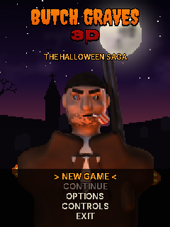
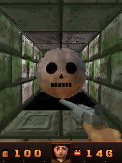
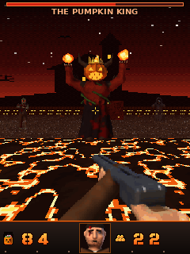
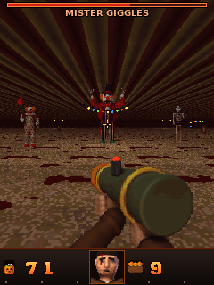
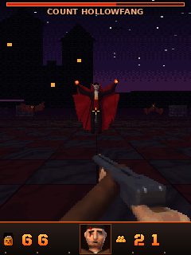
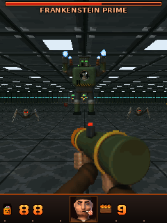
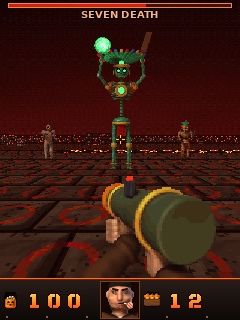
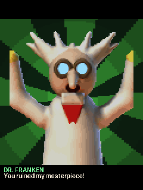
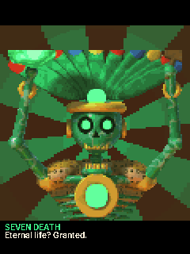
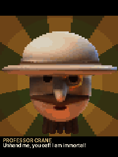

# BUTCH GRAVES 3D

*An experiment: can Claude Opus 5.5 build a complete game for twenty-year-old phones?*

  
  
  

The target was not a tech demo but a whole game: a Duke Nukem 3D–style shooter for the Java (J2ME) phones of the
mid-2000s, with episodes, bosses, cutscenes, music and voices. The platform is MIDP 2.0 / CLDC 1.0, with keypad controls
and screens from 128×128 to 240×320. It has no floating point, a few megabytes of memory at best, a 1 MB JAR limit on
many phones, and audio firmware that is famously fragile.

A human gave the brief and the direction (for example, a fifth episode in an Indiana Jones–style jungle, with a foggy
night level like Silent Hill), played the builds and reported what was wrong. Claude did everything else: it wrote the
game, and made every level, picture, tune and voice with tools it wrote for the job. It worked in a Linux cloud
sandbox with no phone, so it also had to build its own ways to see and test what it made.

## What came out

A Halloween shooter in five episodes, each ending with a boss and an animated cutscene.

| Episode | Setting | Boss |
|---|---|---|
| 1. Night of the Pumpkin King | A cemetery, a haunted manor and catacombs | The Pumpkin King |
| 2. Carnival of Carnage | A carnival of killer clowns | Mister Giggles |
| 3. Bite Night | A bayou, a mad lab and a vampire's castle | Count Hollowfang |
| 4. Voltage of the Damned | A robot factory on Halloween 2099 | Frankenstein Prime |
| 5. Curse of the Jade Skull | Jungle temples, and a mission town lost in fog | Seven Death |

  
  
  
  
  

In numbers:

- 20 levels, 17 monster types, 5 bosses and 5 weapons.
- Over 300 rendered sprites, 25 music tracks, 56 sound effects and 88 voice lines.
- About 7,000 lines of Java for the game, 13,000 lines of Python for the tools that made its levels, art and audio, and
  5,000 lines of tests.
- A 1.7 MB JAR, and a lite build without the voices that fits under 1 MB.

## How the art was made

There is no drawn or downloaded art in the game. Every image comes out of Python scripts in `tools/`.

**Monsters, weapons, props and Butch** are 3D models written as code, then rendered into sprites, much as Doom's
artists photographed clay models.

- **The models** are built from simple shapes: spheres, ellipsoids, boxes, cones, cylinders and tori. The shapes are
  blended into each other with smooth unions and carved with subtractions. Noise is pushed into their surfaces for
  wrinkles, bark and rot. A ghoul is made of 76 shapes, and Seven Death, the last boss, of 130.
- **Materials** take their colour from 3D noise (skin, cloth, rust, bone) and can glow. Glowing parts, such as eyes,
  fire and the jack-o'-lantern faces, stay bright in the dark in the game.
- **The renderer** is a small ray marcher that Claude wrote in numpy (`tools/sdf.py`). It lights every model with a warm
  key light that casts soft shadows, a cold moonlight rim and an orange glow from below. It adds ambient occlusion in
  the creases and supersamples the edges.
- **Each monster** gets two walking frames plus attack, pain, falling and dead frames. When a monster dies, its glowing
  eyes go dark.
- **For the cutscenes**, the villains and Butch are also rendered as big close-up portraits, with two mouth positions
  so they can "talk". The first-person guns and Butch's hands are rendered the same way, from a camera at eye height.

**Textures and skies** are procedural 64×64 tiles that wrap seamlessly: stone blocks, mossy temple walls, rusted
metal, circus stripes, circuit boards, lava and rivers. They are made from tileable noise and brick and plank
generators, with signs lettered in a font. The skies are 360° panoramas: a blood moon over Hollow Creek, a neon city
for 2099, and jungle hills with a pyramid and a volcano.

**Everything shares one 256-colour palette.** All the art is pooled and reduced to 223 colours with median cut and
k-means. Sprite colours count three times as much as the rest, because monsters must look right. 31 more colours are
kept for things that glow. At run time the engine builds 32 shades of the palette that fade towards each level's fog
colour.

Claude reviewed its art by rendering contact sheets of every frame, and in-game frames from the real engine, and
looking at them. That review is how it caught problems like guns hiding Butch's hands, or skeletons missing their
arms.

  
  
  

## How the levels were made

Each level is a Python function that lays out the map on a 64×64 grid. Rooms, corridors, doors, keys, monsters and
props are placed by coordinates with a few helpers, and each cell gets its own floor, ceiling and light level. The
level gadgets are placed the same way: teleporter pads, levers, conveyor belts, pits, dart traps, the rolling boulder
and the trigger that turns the fog town into the Other World.

Before a level is written out, a validator checks it:

- The map is closed all round, and every door sits between two walls.
- Nothing stands in a wall or a pit.
- With the keys you can collect, the exit can be reached. The search follows teleporters, both positions of the
  shifting walls, jumps over pits, and the escape route after the idol is taken.
- Every piece of art the level uses is in the level's asset list.

The validator also draws a map preview to check by eye.

## How the music and sounds were made

**Music.** All 25 tracks are General MIDI, written note by note in Python and saved by a small MIDI writer in
`tools/gen_audio*.py`.

- Riffs and melodies are written as lists of note names. Power chords, drum patterns and fills come from helper
  functions.
- Each track picks its General MIDI instruments and its own style: surf-horror for the cemetery, a broken circus
  waltz, swamp blues, circus metal, synthwave for 2099, a jungle adventure march, and a war-drum ritual in E Phrygian
  for the last boss.
- The title theme opens with Bach's Toccata in D minor.
- Claude can't listen to music, so it checked the tracks by rendering them through a General MIDI soundfont and
  measuring them: length, loudness and how busy they are. The human did the listening.
- The busiest boss tracks were later thinned by a script, so the phone's synthesizer has CPU left over for sound
  effects.

**Sound effects** are synthesized in numpy as 8 kHz, 8-bit WAVs. They are built from noise bursts, pitch sweeps,
envelopes, filters, distortion and a small echo. The revolver, for example, is a noise crack, a low boom and a pitch
drop, run through distortion and a short reverb.

**Voices** are text-to-speech, processed to sound like a 90s game.

- **Butch** is espeak-ng with the MBROLA us2 voice. It is pitched down and run through a telephone EQ, hard
  compression, a slap echo and some grit, all in ffmpeg.
- **The other characters** use Kokoro, a small neural text-to-speech model, with their own effect chains. Seven Death
  is a blend of two voices, pitched down, with a long echo. The talking monsters get a vibrato, which is done in numpy:
  ffmpeg's vibrato filter turned out to produce broken samples.

## The engine

- **No floating point.** CLDC 1.0 has no `float` or `double`, so the renderer is a fixed-point raycaster in integer
  maths. On top of the walls it draws textured floors and ceilings, 360° skies, distance fog, baked flickering light,
  translucent ghosts, sliding doors and secret walls, and a Doom-style screen melt.
- **Memory.** The art is packed into one small pack that is always loaded, plus about 200 groups that load level by
  level. A level never holds more than about 390 KB of art at once.
- **Screen sizes.** Menus, subtitles and the status bar size themselves to the screen and to the phone's own fonts.
- **Cutscenes** are scripted in code and played in the game engine. Actors are ordinary sprites moved by the script,
  with camera moves, voices, subtitles and talking close-ups.
- **Sound.** All phone audio runs on a background thread with a watchdog. The engine works around firmware that
  deadlocks, hangs, runs out of channels or stops the music to play an effect.

## How it was tested

Claude had no phone, so the testing was built in layers.

**A desktop simulator** (`test/sim`) compiles the game's own engine and world code against stand-ins for the phone APIs,
so the real game logic runs on a PC.

- **Sweep** sends a god-mode bot through every level on every difficulty. It reports crashes, kills, and the damage
  each monster type deals.
- **BossBot** plays each boss fight like a decent human: imperfect aim, limited turning speed, strafing to dodge, and
  grabbing health when it's low. Its win rates were used to tune all five bosses to the same curve. For example, the
  last boss went from 0 of 8 wins on normal to 5 of 8.
- **Rooms, Count and Count2** check that every room with monsters has supplies, and that each difficulty leaves enough
  health and ammo for the monsters it holds.
- **Mech and Mech5** run the gadgets through the real world code: teleporters, levers, conveyors, shock floors, pits,
  darts, spikes, the boulder, the rising mummy, the radio and the Other World.
- **Shot tools** render real frames from the engine to PNG: posed scenes, secret walls mid-slide, and every weapon
  frame at several light levels. Claude looks at these, and they are also how the screenshots here were made.

**An emulator.** FreeJ2ME runs the real JAR headless, driven by scripts of key presses that also take screenshots. It
was used to check menus, story pages, cutscenes, the full and lite builds, and screen sizes from 128×128 to
240×320 and 320×240 landscape.

**A fake phone audio system** (`test/snd`) stands in for the phone's sound API. It reproduces 12 failure modes of real
phone firmware:

- a mixer that deadlocks when music stops under an effect;
- random hangs;
- running out of players;
- lost restarts on emulators;
- only one channel;
- no mixing of effects with music;
- hangs while loading during music;
- music that hangs on start;
- hangs with too many players;
- the music's channel taken by an effect, at once or a moment later;
- loop counts ignored.

Three tests run the sound engine against every model:

- **SndTest** checks dying and restarting.
- **GunTest** checks that every shot of every gun is heard.
- **BossTest** plays a minute of boss fight and reports which sounds were heard and how much of the time the music
  really played.

**The build** compiles to Java 1.3 bytecode against MIDP/CLDC stubs, and ProGuard shrinks and preverifies it. The
lite JAR's size is checked against the 1 MB limit.

The human's playtesting covered what none of this could: how the game feels, sounds and plays on a real device.

## Caveats

- Testing was mostly in a simulator, in emulators and against the fake audio system. Real phones from 2006 vary a lot,
  especially in their audio. Some can't play sound effects over music at all.
- The voices are text-to-speech and sometimes sound like it.
- It is a raycaster, like Wolfenstein with extras from Doom. That means flat floors and no rooms above rooms.

## Try it

| File | |
|---|---|
| `dist/ButchGraves3D.jar` + `.jad` | The full game (1.7 MB) |
| `dist/ButchGraves3D_lite.jar` + `.jad` | Without voice lines, under 1 MB |

It runs on MIDP 2.0 phones and in J2ME Loader, KEmulator and FreeJ2ME.

**Controls:**

| Key | Action |
|---|---|
| 2 / 8 | Walk forward / back (double-tap 2 to sprint) |
| 4 / 6 | Turn |
| 1 / 3 | Strafe |
| 5 | Fire |
| 0 | Use |
| 7 / 9 | Switch weapon |
| # | Jump |
| * | Map |

The **[manual](MANUAL.md)** covers everything about playing: every weapon, pickup, trap and gadget, every monster and
boss, all twenty levels with maps and every secret, difficulty, options and cheats. The
**[developer notes](DEVELOPER.md)** cover building it from source and swapping in your own music and voices.

## Credits

The code, art, music, sound and story were made for this project. The logo, HUD digits and texture signs are drawn with
the Creepster, Nosifer and Black Ops One fonts (SIL Open Font License). The title theme opens with J. S. Bach's Toccata
and Fugue in D minor, BWV 565 (public domain).
